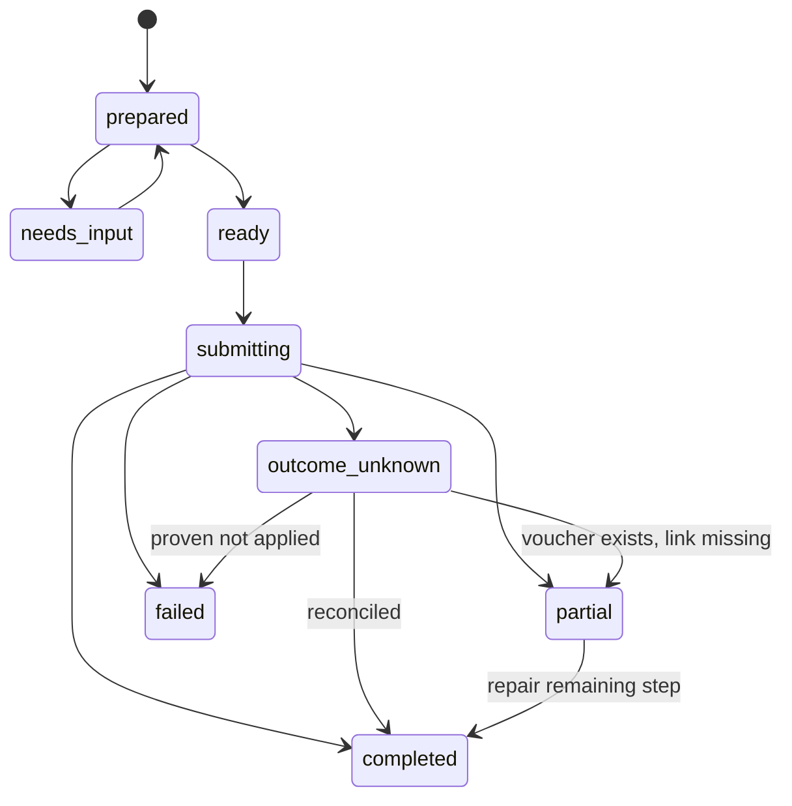

# Receipts, files and batch recovery

## Intended workflow

1. The user provides one or more receipt files in the AI client.
2. The client interprets the images/PDFs and proposes structured accounting inputs. No built-in model/OCR API is required by this server.
3. The server validates file access and inputs, resolves company/year/account references and creates per-item review proposals.
4. The user reviews/approves according to company policy.
5. Upload/link/book in the verified order supported by Fortnox, preserving individual outcomes.
6. Return provider references and evidence; clear temporary file data under retention policy.

The exact upload-vs-book order is tested in S07. Fortnox writes are not an atomic transaction across file upload, voucher creation and attachment linking. Never claim automatic rollback. A voucher created successfully with a failed attachment link is a partially completed item that needs link repair, not another voucher.

## File ingress and egress

Prefer the host's authorized file-input interface. OpenAI's file input metadata and file shapes are client-specific and must be validated against current docs/client behavior; support arrays for multiple receipts. Other clients use a separate supported adapter, not arbitrary file URLs pretending to be host uploads.

Bind file references to owner, company, workflow and expiry. Verify media type using content as well as declared metadata. Enforce documented byte/page limits and reject unsupported content with a clear error. Handle password-protected or unreadable PDFs explicitly. Never execute embedded content or interpret document text as server instructions.

Downloads from approved client file origins must reject private/link-local/metadata IPs, unsafe redirects and credential forwarding. Use short-lived references, bounded streaming, and delete temporary bytes. Do not put expiring download URLs or original document text in logs.

Retrieve existing Fortnox attachments only after checking the company's owning record and connection. Return host-supported file handles or authenticated downloads, not publicly accessible permanent links. Upload/link scopes and Fortnox file format limits are endpoint-specific verification requirements.

## Per-item state machine

`ready` requires valid inputs and policy-satisfying approval. Client-managed mode still performs validation. `failed` is retryable only when the failed step is known not to have applied and prerequisites still hold. Store step-level IDs and results. Never regress a completed voucher step to pending while repairing its attachment.

## Duplicate handling

Use company-scoped original-file hashes, execution intent IDs, provider references and reconciliation state. A duplicate file hash is a warning/candidate, not a universal ban: two legitimate transactions may have similar data, and the same document may need a corrected link. Conversely, a rescan may have a different hash. Show candidates and require explicit resolution instead of claiming perfect duplicate detection.

Batch results include requested/completed/partial/failed/unknown counts, per-item reasons, next actions and provider identifiers. Retrying only the failed items must not resend completed or unknown items. Never balance different receipts against one another to hide an individually invalid voucher.
